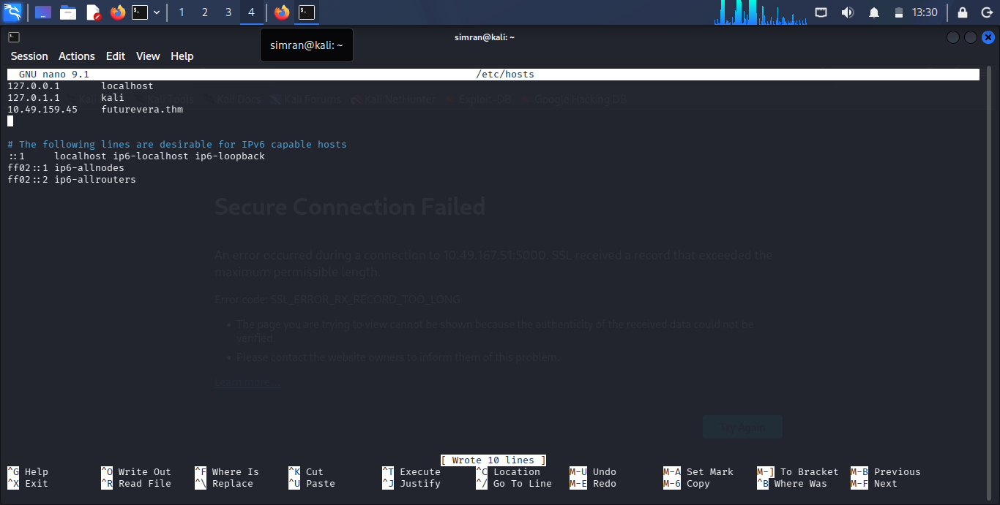
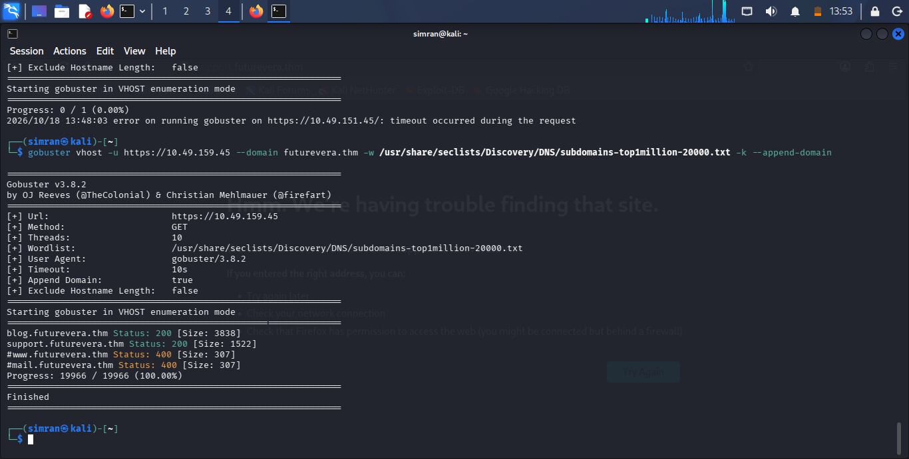
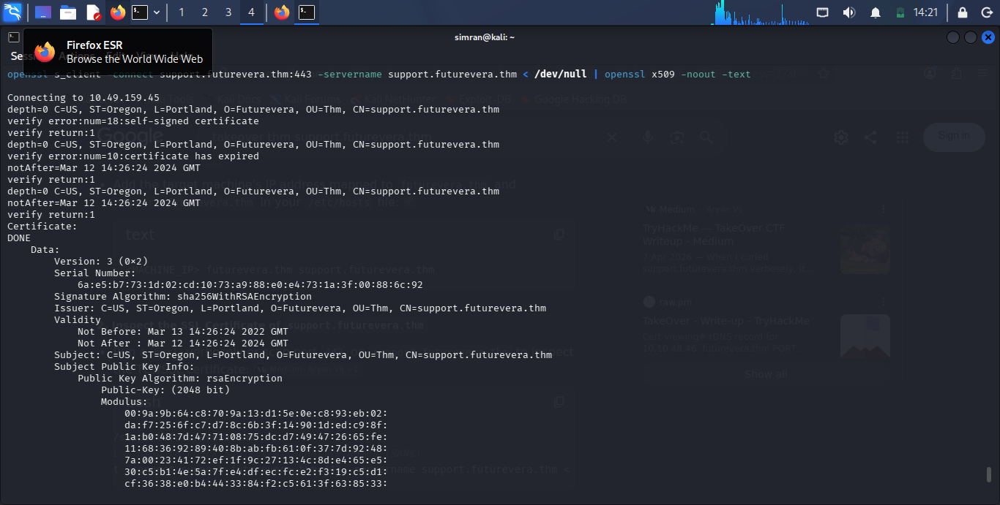
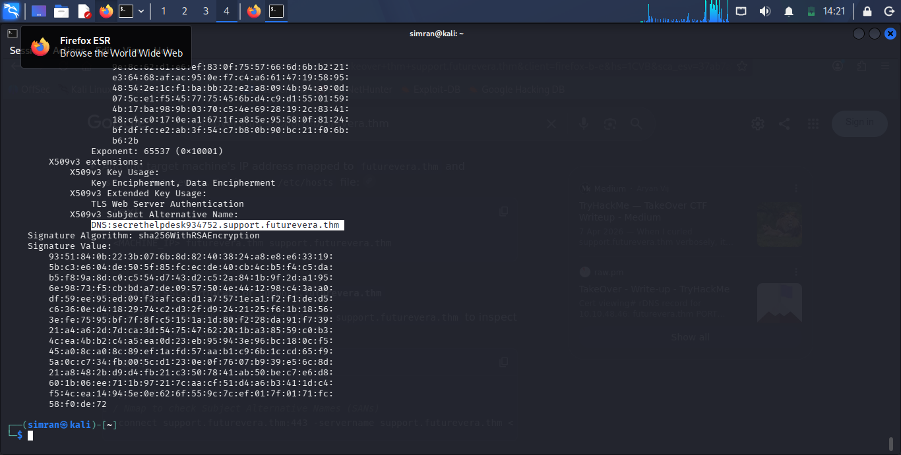
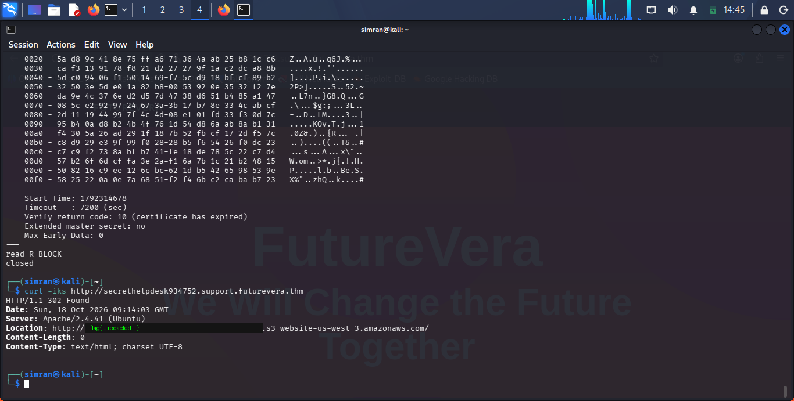

<div align="center">

# 🎯 TakeOver

### a TryHackMe box about digging through certs to find a subdomain nobody meant to leave public


</div>

---

## 👋 So what's this room about

This one's called **TakeOver**, and honestly the name is a little misleading going in — I spent the first 20 minutes expecting some kind of subdomain-takeover attack (the classic "dangling DNS" thing). What it actually turned out to be was more of a "read the SSL certificate properly, nerd" lesson. The target is a company called **Futurevera**, running a site at `futurevera.thm`, and buried somewhere in its infrastructure is a support subdomain that isn't linked anywhere on the actual website.

> ⚠️ Per usual CTF-etiquette, I'm **not** posting the actual flag here. If you want it, go do the room yourself — it's a fun one. Screenshots below have the flag blacked out.

---

## 🧰 What I used

- Kali Linux (attack box)
- `gobuster` (vhost mode)
- `openssl s_client` + `openssl x509` to read certs manually
- `curl`
- good old `/etc/hosts`

---

## 🪜 How it went down

### 1. Pointed my hosts file at the box

First thing, as always with THM web rooms — grab the target IP and shove it in `/etc/hosts` so `futurevera.thm` actually resolves to something.

```
10.49.159.45    futurevera.thm
```



Nothing fancy here, just setup. Once this is in, the site loads like a normal website would.

### 2. Vhost brute-forcing to see what else is hiding behind that IP

A single domain rarely tells the whole story, so I ran `gobuster` in vhost mode against the IP directly, appending `futurevera.thm` to every word in the wordlist to check for subdomains:

```bash
gobuster vhost -u https://10.49.159.45 --domain futurevera.thm \
  -w /usr/share/seclists/Discovery/DNS/subdomains-top1million-20000.txt \
  -k --append-domain
```

Came back with a couple of hits:

```
blog.futurevera.thm      Status: 200 [Size: 3838]
support.futurevera.thm   Status: 200 [Size: 1522]
#www.futurevera.thm      Status: 400 [Size: 307]
#mail.futurevera.thm     Status: 400 [Size: 307]
```



`support.futurevera.thm` looked like the interesting one — support portals usually are.

### 3. Pulling the TLS cert by hand instead of trusting the browser

Normally I'd just open the site in Firefox, but the cert on this thing is self-signed **and expired**, so the browser just throws a wall of "Secure Connection Failed" in your face and doesn't let you poke around easily. Instead of fighting the browser, I grabbed the raw cert straight from the socket:

```bash
openssl s_client -connect support.futurevera.thm:443 \
  -servername support.futurevera.thm < /dev/null | openssl x509 -noout -text
```



Yeah, it complains — self-signed, expired, all of that. Didn't matter, I just wanted to read the cert fields, not actually trust it for anything.

### 4. The SAN field snitched 🐍

This is the actual "aha" moment of the room. Certs have a field called **Subject Alternative Name (SAN)** — it's meant to list every hostname a cert is valid for. Admins sometimes reuse one cert across a "main" domain and a handful of internal/testing subdomains, without realizing that field is basically a free list of hostnames for anyone who bothers to check it.

Scrolling through the cert output, there it was:

```
X509v3 Subject Alternative Name:
    DNS:secrethelpdesk934752.support.futurevera.thm
```



`secrethelpdesk934752.support.futurevera.thm` — never showed up in gobuster, never linked from the site, just quietly sitting in the certificate because whoever issued it included it there. Classic case of a cert leaking infrastructure nobody meant to expose.

### 5. Curling the secret subdomain

Pointed `curl` at the newly discovered subdomain:

```bash
curl -iks http://secrethelpdesk934752.support.futurevera.thm
```

And got a `302 Found` with a `Location` header redirecting off to an S3 bucket — and the bucket name itself was the flag (a nice "the flag was in the URL the whole time" kind of twist).



Grabbed it, submitted it, room done. 🎉

---

## 🧠 What I actually learned from this one

- **Browser cert errors aren't a wall, they're a prompt.** When Firefox refuses to show you a site because of a cert problem, that's exactly when `openssl s_client` is more useful than the GUI — you can read everything about the cert without needing it to be "valid."
- **SAN fields are an underrated recon source.** People focus so much on subdomain wordlists (gobuster, ffuf, etc.) that they forget the cert itself might just... tell you the hostnames. Especially with self-signed or internally-issued certs where someone bundled a bunch of hostnames into one cert for convenience.
- **Vhost brute-forcing and cert inspection are complementary, not either/or.** Gobuster found `support.futurevera.thm` for me; it never would've found `secrethelpdesk934752.support.futurevera.thm` because that name is random-looking and not in any wordlist. The cert is what cracked that part open.
- **A redirect `Location` header is a classic hiding spot.** Worth always eyeballing response headers, not just body content, when poking at an endpoint.

---

## 🤐 About the flag

Not posting it — screenshot above has it blacked out on purpose. If this room's on your list, the method above gets you 90% of the way there; the last step is just running the curl command yourself.

---

<div align="center">

🏳️ *Writeup by [Simranjit Kaur](#) — part of a running [CTF writeup collection](../README.md)*

</div>
