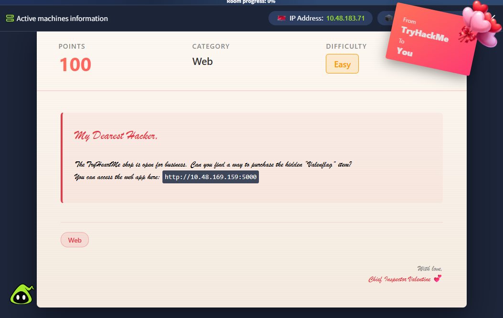
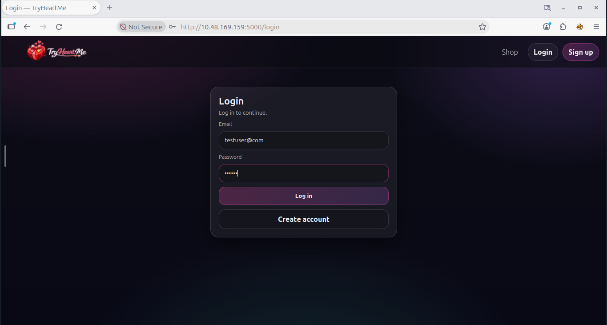
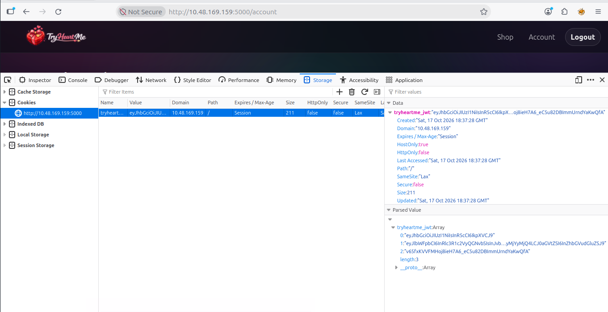
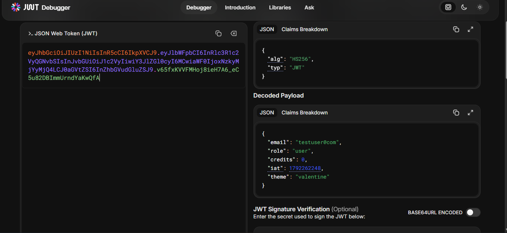
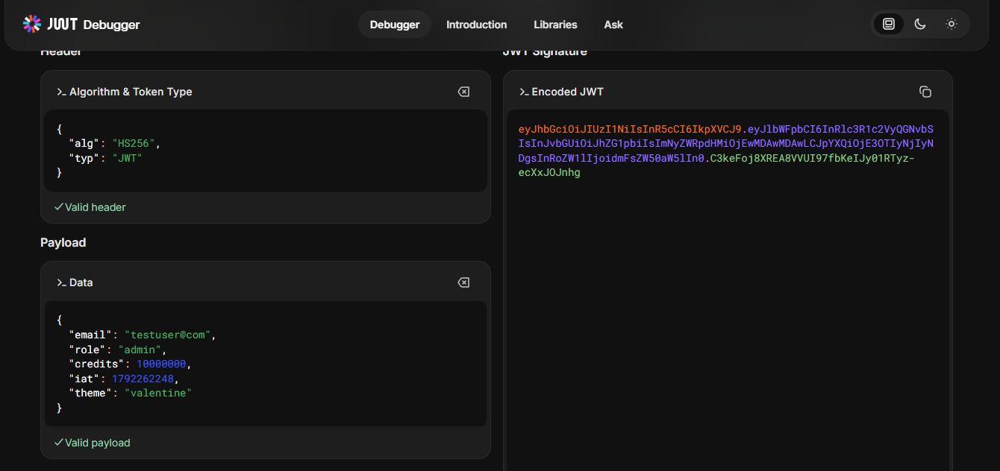
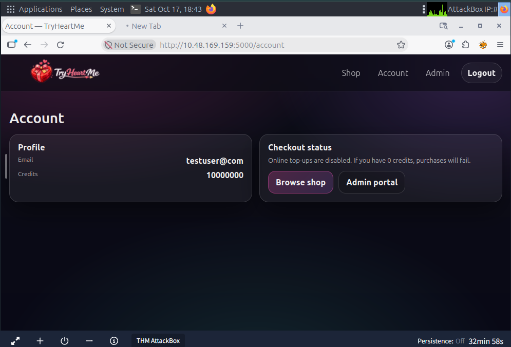
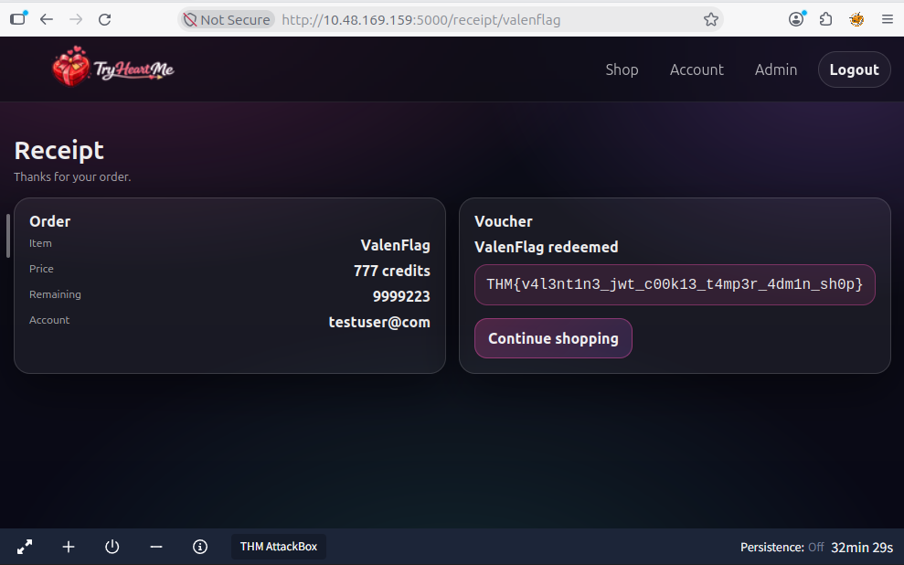
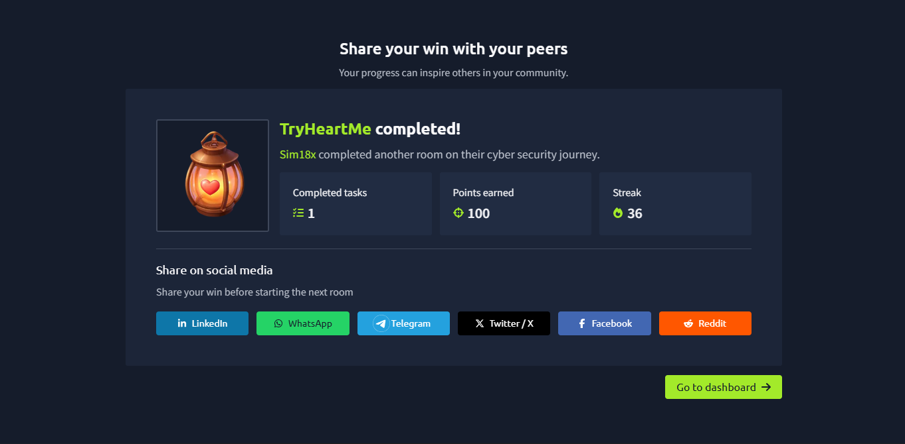

<div align="center">

# 💌 TryHeartMe

### JWT Privilege Escalation via Missing Signature Verification


*A Valentine-themed shop that trusts whatever its users tell it — including who they are.*

</div>

---

## 📑 Table of Contents

- [TL;DR](#-tldr)
- [Room Info](#-room-info)
- [Objective](#-objective)
- [Environment \& Tools](#-environment--tools)
- [Methodology](#-methodology)
  - [Step 0 — Room Overview](#step-0--room-overview)
  - [Step 1 — Recon \& Account Creation](#step-1--recon--account-creation)
  - [Step 2 — Finding the Session Token](#step-2--finding-the-session-token)
  - [Step 3 — Decoding the JWT](#step-3--decoding-the-jwt)
  - [Step 4 — Forging the Claims](#step-4--forging-the-claims)
  - [Step 5 — Replaying the Forged Token](#step-5--replaying-the-forged-token)
  - [Step 6 — Buying the Staff-Restricted Item](#step-6--buying-the-staff-restricted-item)
  - [Step 7 — 🚩 Flag Capture](#step-7---flag-capture)
- [Root Cause](#-root-cause)
- [Impact](#-impact)
- [Remediation](#-remediation)
- [Key Takeaway](#-key-takeaway)

---

## ⚡ TL;DR

> The app puts `role` and `credits` **inside** a JWT cookie and never checks the signature when it reads them back.
> Decode → edit `role: "user"` → `role: "admin"`, bump `credits` → paste the cookie back in → the server just believes you. 🤝

```jsonc
// before
{ "role": "user",  "credits": 0 }

// after (self-forged, no secret key needed)
{ "role": "admin", "credits": 10000000 }
```

**Flag:** `THM{v4l3nt1n3_jwt_c00k13_t4mp3r_4dm1n_sh0p}`

---

## 🧾 Room Info

| | |
|---|---|
| **Author** | Simranjit Kaur |
| **Platform** | TryHackMe |
| **Room** | TryHeartMe |
| **Category** | Web Exploitation |
| **Difficulty** | 🟢 Easy |
| **Vulnerability Class** | Broken Access Control — Unverified / Forgeable JWT ([CWE-347](https://cwe.mitre.org/data/definitions/347.html), [CWE-285](https://cwe.mitre.org/data/definitions/285.html)) |

## 🎯 Objective

Find a way to purchase the hidden **`ValenFlag`** item in the TryHeartMe shop, starting from a freshly registered account sitting at **0 credits**.

## 🛠️ Environment & Tools

- 🌐 **Target:** TryHeartMe web app (THM AttackBox network, port `5000`)
- 🦊 **Browser:** Firefox DevTools — Storage / Cookies panel
- 🔑 **JWT Tooling:** Online JWT debugger (decode + re-encode header / payload / signature)

---

## 🔍 Methodology

### Step 0 — Room Overview

The room brief lays it out plainly: the shop is open, and somewhere in it is a hidden `ValenFlag` item waiting to be bought.

<details>
<summary>📸 Figure 1 — Room overview page (click to expand)</summary>



</details>

### Step 1 — Recon & Account Creation

1. Registered a new account and logged in — starting balance: **0 credits**.
2. Tried browsing straight to the `ValenFlag` item as a plain `user` role → **access denied**. It's gated to **staff/admin** accounts only, which confirmed privilege escalation was the actual path forward, not just saving up credits.

<details>
<summary>📸 Figure 2 — Register & login (click to expand)</summary>



</details>

### Step 2 — Finding the Session Token

Popped open DevTools → **Storage → Cookies** and found `tryheartme_jwt` — a JSON Web Token being used for session/authorization state instead of (or alongside) a server-side session.

<details>
<summary>📸 Figure 3 — JWT cookie in DevTools (click to expand)</summary>



</details>

### Step 3 — Decoding the JWT

Dropped the token into a JWT debugger. Header says `HS256`. Payload says a lot more than it should:

```json
{
  "email": "testuser@com",
  "role": "user",
  "credits": 0,
  "iat": 1792262248,
  "theme": "valentine"
}
```

🚩 **Red flag:** authorization-sensitive fields (`role`, `credits`) are sitting in plaintext inside a client-readable, client-writable cookie.

<details>
<summary>📸 Figure 4 — Decoded payload (click to expand)</summary>



</details>

### Step 4 — Forging the Claims

Edited the payload directly in the debugger's encoder — no signing secret needed, because (spoiler) the server never checks one on the way back in:

```diff
- "role": "user",
- "credits": 0,
+ "role": "admin",
+ "credits": 10000000,
```

<details>
<summary>📸 Figure 5 — Forged JWT (click to expand)</summary>



</details>

### Step 5 — Replaying the Forged Token

Swapped the `tryheartme_jwt` cookie value for the forged token, refreshed the page, and… the app just accepted it. Account view flipped to admin-level, credits now read `10,000,000`, and a shiny new **Admin portal** link appeared.

<details>
<summary>📸 Figure 6 — Elevated account view (click to expand)</summary>



</details>

### Step 6 — Buying the Staff-Restricted Item

With a forged `admin` role and a functionally unlimited balance, the previously-blocked `ValenFlag` item was now reachable in the shop. Checked out — receipt confirmed the order and revealed the redeemed voucher.

<details>
<summary>📸 Figure 7 — Purchase receipt (click to expand)</summary>



</details>

### Step 7 - 🚩 Flag Capture

```text
THM{v4l3nt1n3_jwt_c00k13_t4mp3r_4dm1n_sh0p}
```

Submitted it, room complete. 🎉

<details>
<summary>📸 Figure 8 — Room completed (click to expand)</summary>



</details>

---

## 🧠 Root Cause

JWTs are **signed, not encrypted** — the header and payload are just Base64URL, readable and editable by anyone holding the token. The signature is the *only* thing that tells the server "this content hasn't been tampered with since I issued it."

TryHeartMe decodes the payload and trusts `role` and `credits` straight out of it **without ever re-checking the signature or cross-referencing a trusted data store.** That turns a client-writable cookie into a privilege-escalation and free-money glitch rolled into one.

## 💥 Impact

| Risk | Description |
|---|---|
| 🔓 **Privilege escalation** | Any logged-in user can self-promote to admin with zero knowledge of the signing secret. |
| 💸 **Business logic abuse** | Credits (and presumably prices/discounts elsewhere) are forgeable → free purchases. |
| 🧩 **Broad trust violation** | Any future claim added to this token inherits the same flaw — this isn't a one-off bug, it's a pattern. |

## 🛡️ Remediation

- ✅ **Verify the signature** on every request, server-side, before trusting any claim — reject on failure.
- ✅ **Never trust client-supplied authorization state** — look up `role` / `credits` from a server-side store, not the token.
- ✅ **Short-lived tokens** with a refresh flow, to cap the blast radius of a leaked/forged token.
- ✅ **Pin the algorithm** server-side; reject `"alg": "none"` or unexpected algorithms.
- ✅ **Harden the cookie:** `HttpOnly`, `Secure`, `SameSite`, and HTTPS everywhere.
- ✅ **Audit/alert** on role changes that don't trace back to an explicit admin action.

## 💡 Key Takeaway

> If a value drives an authorization or money decision, it belongs in a database the server controls — not in a cookie the client can edit with a text box and five minutes.

---

<div align="center">

🏳️ *Writeup by [Simranjit Kaur](#) — part of a running [CTF writeup collection](../README.md)*

</div>
